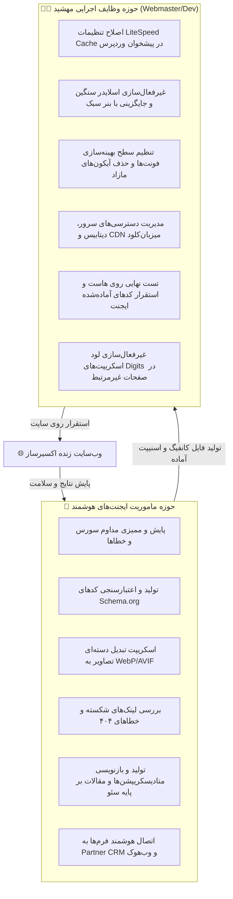

# ماتریس تفکیک وظایف: ایجنت‌های هوشمند در برابر تسک‌های اجرایی مهشید
**استراتژی توسعه چابک:** تفکیک مهندسی میان اتوماسیون با عامل‌های هوش مصنوعی (AI Agents) و اقدامات مستقیم توسعه‌دهنده (مهشید).

---

## ۱. منطق تفکیک کار (Division of Labor Logic)

---

## ۲. جدول مقایسه‌ای و ماتریس مسئولیت‌ها (RACI Matrix)

| حیطه عملیاتی | شرح تسک | متولی اصلی | نقش ایجنت هوشمند | نقش مهشید | ابزار / مهارت مورد نیاز |
| :--- | :--- | :---: | :--- | :--- | :--- |
| **اصلاح فاجعه CSS اینلاین (۱.۳ مگابایت)** | خاموش کردن Inline CSS و تفکیک استایل‌ها در LiteSpeed | **مهشید** | تدوین دستورالعمل گام‌به‌گام و مانیتورینگ خروجی پس از تغییر | ورود به پنل وردپرس و اعمال تنظیمات در تب Page Optimization | LiteSpeed Cache / WP Admin |
| **کاهش وزن تصاویر (WebP Pipeline)** | تبدیل تمام تصاویر سنگین PNG/JPG به WebP با حفظ کیفیت | **ایجنت + مهشید** | اجرای اسکریپت پایتون/Node برای تبدیل و فشرده‌سازی لایت | آپلود یا فعال‌سازی WebP Replacement در لایت‌اسپید | اسکریپت ایجنت / Pillow / cwebp |
| **تزریق اسکیماهای حرفه‌ای B2B** | افزودن Organization, Product, FAQ, Breadcrumb | **ایجنت** | تولید کدهای ۱۰۰٪ استاندارد JSON-LD و تست با Google Rich Results | قرار دادن کد در هدر قالب یا افزونه Rank Math / Snippets | Skill: SEO Schema Architect |
| **پاکسازی صفحات رهاشده و ارور ۴۰۴** | اصلاح اسلاگ‌های اشتباه (`/لیست/`) و ریدایرکت ۳۰۱ | **ایجنت + مهشید** | استخراج تمام URLها از sitemap و لاگ ۴۰۴ها و پیشنهاد ریدایرکت | تایید نهایی و ذخیره ریدایرکت‌ها در Rank Math | WP REST API Crawler |
| **جایگزینی اسلایدر سنگین رولوشن** | حذف RevSlider از هدر و جایگزینی با Hero Section فوق سبک | **مهشید** | کدنویسی کامپوننت فرانت‌اند سبک (HTML5/CSS) | غیرفعال کردن شورت‌کد اسلایدر و درج کدهای جدید در صفحه | WPBakery / Gutenberg / CSS |
| **محدودسازی پلاگین Digits** | لود شرطی فرم‌های پیامک فقط در صفحه لاگین | **ایجنت** | نوشتن هوک PHP برای `wp_dequeue_script` در صفحات دیگر | قرار دادن اسنیپت در `functions.php` یا Code Snippets | PHP Snippet Agent |
| **اتصال لیدها به پورتال سازمانی** | اتصال فرم‌های استعلام قیمت به دیتابیس CRM | **ایجنت** | ایجاد وب‌هوک و اسکریپت دریافت داده از Contact Form 7 | نصب وب‌هوک یا افزونه CF7 Webhook روی سایت | Skill: CRM Alignment |
