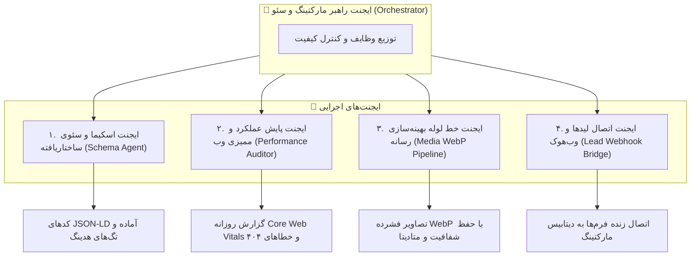

# معماری ایجنت‌های هوشمند و اتصال اسکیل‌های گیتهاب (AI Agent System & GitHub Skills)
**پروژه:** شتاب‌دهی و حل عیوب فنی وب‌سایت اکسیرساز شمال با هوش مصنوعی مستقل  

---

## ۱. نقشه راه ایجنت‌های تخصصی (Agentic Ecosystem)

برای اینکه بیش از ۷۰٪ بار بهبود و تحلیل به صورت خودکار توسط ایجنت‌ها انجام شود و مهشید فقط کارهای نیازمند دسترسی سرور را اجرا کند، ۴ ایجنت تخصصی طراحی و پیاده‌سازی می‌شوند:

---

## ۲. مشخصات و عملکرد هر ایجنت

### ۲.۱. ایجنت اسکیما و سئوی صنعتی (`schema-seo-agent`)
* **هدف:** تولید هوشمند کدهای داده‌های ساختاریافته (Schema.org JSON-LD) منطبق بر استانداردهای ۲۰۲۶ گوگل.
* **اسکیماهای تحت پوشش:**
  - `Organization` و `Manufacturer`: معرفی کارخانه با ظرفیت ۵,۰۰۰ تن، جوایز ملی و موقعیت مکانی.
  - `Product`: افزودن متادیتا برای شیدهای ۳۰٪ تا ۹۰٪، کیسه‌های راشل و توری‌های ضدتگرگ همراه با مشخصات فنی (عرض، گرماژ، گارانتی UV).
  - `FAQPage`: استخراج سوالات متداول باغداران و گلخانه‌داران و فرمت‌بندی پرسش‌وپاسخ برای گوگل.
* **مهارت‌های قابل استفاده از گیتهاب:**
  - `schema-generator` / `jsonld-lint`
  - پکیج‌های پایتون `extruct` و `rdflib` جهت اعتبارسنجی خودکار.

### ۲.۲. ایجنت پایش و ممیزی عملکرد (`performance-auditor-agent`)
* **هدف:** بررسی مستمر وضعیت سرور، اندازه‌گیری TTFB، چک کردن لینک‌های شکسته و اعتبارسنجی فرانت‌اند پس از هر تغییر توسط مهشید.
* **قابلیت‌ها:**
  - تست خودکار با استفاده از Playwright و Lighthouse.
  - مانیتورینگ وضعیت `MizbanCloud` و هدرهای `LiteSpeed Cache`.
  - هشدار فوری در صورت بروز Cache Miss مداوم یا بازگشت باگ اینلاین CSS.

### ۲.۳. ایجنت خط لوله بهینه‌سازی مدیا (`media-optimizer-agent`)
* **هدف:** دانلود دسته‌ای تصاویر محصول و کارخانه، پردازش و تبدیل با ابزارهای بهینه‌سازی نوین:
  - تبدیل خودکار PNG/JPG به فرمت WebP با کیفیت ۹۰٪ و فشرده‌سازی Lossless.
  - کاهش وزن حداقل ۶۵ درصدی تصاویر بدون افت کیفیت دیداری.
  - افزودن خودکار تگ‌های `alt` غنی از کلمات کلیدی هدف سئو.

### ۲.۴. ایجنت اتصال لیدها به پورتال سازمانی (`crm-lead-bridge-agent`)
* **هدف:** اتصال فرم‌های موجود در وب‌سایت وردپرسی به پنل سرنخ‌های مارکتینگ (`lead.html` و `leads-api.php`).
* **مکانیزم:**
  - بدون نیاز به نصب افزونه‌های سنگین، از طریق هوک وردپرس `wp_remote_post` در Contact Form 7 یا Gravity Forms، لیدها در لحظه به پایگاه داده اکسیرساز منتقل می‌شوند.

---

## ۳. اسکیل‌ها و ابزارهای پیشنهادی از اکوسیستم گیتهاب و مخازن متن‌باز

1. **WordPress REST API Automation CLI:**
   - کنترل و ویرایش مقالات، محصولات و برچسب‌های وب‌سایت بدون نیاز به لاگین در پیشخوان، با استفاده از Application Passwords.
2. **Playwright WebApp Testing (`webapp-testing`):**
   - برای تست دقیق تجربه کاربری موبایل و استخراج خطاهای کنسول و ناهماهنگی‌های CSS در رزولوشن‌های مختلف.
3. **Pillow & libwebp CLI:**
   - پایپ‌لاین تولید سریع نسخه‌های ریسپانسیو و متناسب با ابعاد صفحه‌نمایش.
