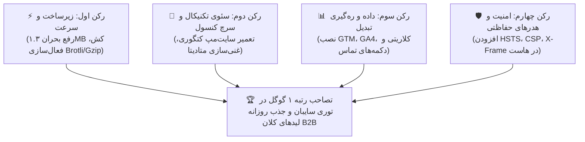

# برنامه راهبردی مدیریت، عیب‌یابی و رشد وب‌سایت اکسیرساز شمال (Website Operations & Growth Blueprint)
**نقش سازمانی:** مدیر ارشد وب‌سایت و سئوی تکنیکال (Chief Webmaster & Technical SEO Director)  
**ناظر عالی:** نوید نیستانی (مدیر مارکتینگ و رشد)  
**مجری فنی:** مهشید (Webmaster / Developer)  
**افق برنامه‌ریزی:** پاییز و زمستان ۱۴۰۵ (برنامه ۹۰ روزه جهش رتبه و تبدیل)  

---

## ۱. مانیفست مدیریت وب‌سایت: از کاتالوگ فرسوده به موتور لیدجنریشن صنعتی

وب‌سایت فعلی شرکت دانش‌بنیان **اکسیرساز شمال** (`exirsaz.com`)، علی‌رغم داشتن اعتبار ۲۴ ساله کارخانه، افتخار جایزه ملی کیفیت، و تجهیز به ماشین‌آلات پیشرفته کارل مایر آلمان، به دلیل انباشت عیوب فنی، عدم مدیریت کش و سایت‌مپ‌های ناقص، در رتبه‌های گوگل پشت سر واسطه‌ها و فروشگاه‌های عمومی (نظیر فامکو، ترب و دیجی‌کالا) قرار گرفته است.

به عنوان **مدیر وب‌سایت شما**، رویکرد ما در این فاز **«توقف کامل اضافه کردن امکانات و افزونه‌های جدید»** و در عوض **«انجام پاکسازی عمیق، بهینه‌سازی کدهای موجود، اصلاح تنظیمات سرور و اجرای سیستماتیک استانداردهای سئو»** است.

---

## ۲. ارکان چهارگانه مدیریت و رشد وب‌سایت (The 4 Operational Pillars)

---

## ۳. نقشه راه ۹۰ روزه عملیات وب‌سایت (90-Day Execution Roadmap)

### 🔹 فاز اول: تثبیت اضطراری و جهش سرعت (روز ۱ تا ۱۴) — تمرکز ۱۰۰٪ روی مهشید
* **هدف:** کاهش حجم صفحه اصلی از ۱.۴۶ مگابایت به زیر ۱۵۰ کیلوبایت و افت زمان بارگذاری به زیر ۲ ثانیه.
* **اقدامات کلیدی:**
  1. خاموش کردن گزینه درون‌ریزی CSS (Inline CSS) در افزونه LiteSpeed Cache.
  2. درج کدهای فشرده‌سازی Deflate در فایل `.htaccess` و فعال‌سازی فشرده‌سازی در میزبان‌کلود.
  3. اعمال اسنیپت لود شرطی افزونه Digits در `functions.php` جهت جلوگیری از بارگذاری فرم‌های مخفی.
  4. درج هدرهای امنیتی پنج‌گانه در `.htaccess`.
* **خروجی این فاز:** وب‌سایت در گوشی تمام کارفرمایان و کشاورزان با سرعت بالا لود می‌شود.

### 🔹 فاز دوم: فتح کلمات کلیدی و تسخیر سئو (روز ۱۵ تا ۴۵)
* **هدف:** فعال‌سازی کامل صفحات دسته‌بندی و بالا کشیدن رتبه «توری سایبان» و «شید گلخانه» از رتبه ۳-۴ به **رتبه ۱ گوگل**.
* **اقدامات کلیدی:**
  1. حل خطای ۴۰۴ در `product-category-sitemap.xml` در افزونه Rank Math.
  2. به‌روزرسانی عناوین سئو و متادیسکریپشن‌های جذاب بر پایه کلمات پرسرچ کارخانه (دستگاه آلمانی، گارانتی ۵ ساله، قیمت مستقیم کارخانه).
  3. ساماندهی تگ‌های هدینگ (H1، H2، H3) در صفحه اصلی و صفحات دسته‌بندی.
  4. اعمال ریدایرکت‌های ۳۰۱ دائمی برای صفحات تست و بی‌محتوا (نظیر `/لیست/`).

### 🔹 فاز سوم: داده‌محوری، ره‌گیری و بهینه‌سازی نرخ تبدیل (روز ۴۶ تا ۷۵)
* **هدف:** حذف نقاط کور مارکتینگ و اندازه‌گیری دقیق تک‌تک لیدها و تماس‌ها.
* **اقدامات کلیدی:**
  1. راه‌اندازی کانتینر Google Tag Manager و اتصال GA4.
  2. فعال‌سازی Microsoft Clarity برای مشاهده ویدیوی کار با سایت توسط مشتریان.
  3. افزودن لینک‌های کلیک‌پذیر `tel:` و دکمه چسبان واتساپ در نسخه موبایل.
  4. راه‌اندازی ایونت‌های Event Tracking برای ثبت کلیک روی دکمه‌های «استعلام قیمت» و «دانلود کاتالوگ».

### 🔹 فاز چهارم: گذار تدریجی از انسان به ایجنت‌های هوشمند (روز ۷۶ تا ۹۰)
* **هدف:** سپردن وظایف تکراری، مانیتورینگ روزانه و به‌روزرسانی داده‌ها به عامل‌های هوش مصنوعی (AI Agents).

---

## ۴. استراتژی گذار: کدام تسک‌ها بعداً از مهشید به ایجنت‌ها منتقل می‌شوند؟

| وظیفه وب‌مستری | در حال حاضر (توسط مهشید) | در آینده (توسط ایجنت خودمختار) |
| :--- | :--- | :--- |
| **مانیتورینگ سلامت و ارورهای ۴۰۴** | چک کردن دستی دوره‌ای در سرچ کنسول | ربات خزش خودکار شبانه و ارسال گزارش به نوید در تلگرام/واتساپ |
| **بهینه‌سازی و تبدیل تصاویر** | فعال‌سازی دستی در افزونه لایت‌اسپید | اسکریپت پایتون ایجنت برای تبدیل فله‌ای تصاویر پوشه Uploads به WebP |
| **نگارش و تزریق اسکیماهای سئو** | کپی‌پیست کدها در قالب | تزریق خودکار هوک‌های JSON-LD بر اساس مشخصات مهندسی محصولات |
| **اتصال فرم‌های استعلام به CRM** | نیازمند افزونه و چک کردن ایمیل‌ها | وب‌هوک مستقیم و ذخیره آنی در دیتابیس بدون دخالت انسان |

---

## ۵. چک‌لیست پایش روزانه و هفتگی مدیر وب‌سایت (KPI Dashboard)

برای اطمینان از سلامت مداوم وب‌سایت، سنجه‌های زیر به صورت هفتگی توسط مدیر وب‌سایت گزارش خواهد شد:
1. **حجم سورس HTML صفحه اصلی:** باید همواره زیر ۱۵۰KB باقی بماند.
2. **وضعیت کش لایت‌اسپید:** هدر `X-LiteSpeed-Cache` در بازدید دوم باید `hit` باشد (نه `miss`).
3. **وضعیت ایندکس سرچ کنسول:** تعداد صفحات Valid در برابر Excluded پایش شود.
4. **نرخ کلیک به تماس (Click-to-Call Rate):** درصد کاربرانی که پس از ورود به صفحه توری سایبان روی شماره تماس کلیک کرده‌اند.
