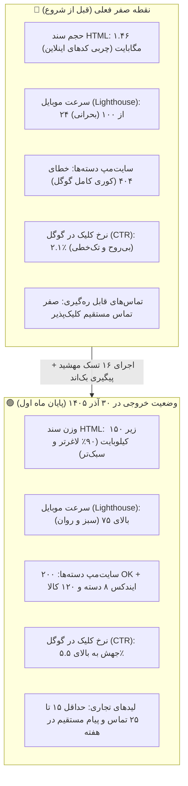

# ویژن تجاری، سنجه‌های ملموس و تارگت ۳۰ روزه وب‌سایت اکسیرساز شمال
**ناظر عالی و مدیر رشد:** نوید نیستانی (کد: ۲۰۱)  
**مسئول فنی و سئو:** مهشید  
**افق ارزیابی:** آذرماه ۱۴۰۵ (برنامه ۳۰ روزه جهش از نقطه صفر)  

---

## ۱. ویژن کلان ۳۰ روزه: مثل بدنسازی، پایان ماه دقیقاً چه خروجی ملموسی می‌بینیم؟

جناب مهندس نیستانی، همان‌طور که در یک دوره تمرینی بدنسازی، شما فقط به دنبال تیک زدن جلسات نیستید و در انتهای ماه سنجش دقیق وزن، درصد چربی و سایز دور بازو را می‌خواهید؛ در وب‌سایت اکسیرساز نیز صرفِ «تیک زدن تسک‌ها توسط مهشید» هدف ما نیست.

**تیک زدن تسک‌ها یعنی «تمرین درست انجام شد»؛ اما سنجه‌های زیر یعنی «نتیجه رشد در کالبد بیزینس ثبت شد»:**

---

## ۲. سنجه‌های پنج‌گانه ارزیابی عملکرد مهشید در جلسه دفاعیه ۳۰ آذر

در جلسه بررسی پایان ماه، شما با باز کردن این ۵ ابزار، کارشناسی بودن عملکرد مهشید را مستقیماً راستی‌آزمایی می‌کنید:

### 🎯 سنجه ۱: تست ترازو (حجم و وزن کدهای صفحه اصلی)
* **نقطه صفر فعلی:** ۱,۴۶۱,۳۷۵ بایت (~۱.۴۶ مگابایت).
* **تارگت پایان ماه:** کمتر از **۱۵۰ کیلوبایت**.
* **نحوه سنجش توسط نوید:** در مرورگر کلید F12 را بزنید، تب Network را باز کنید و صفحه اصلی را رفرش کنید. عدد ستون Size باید به کمتر از ۱۵۰KB سقوط کرده باشد.

### 🎯 سنجه ۲: تست سرعت و چابکی در موبایل (Google PageSpeed / GTmetrix)
* **نقطه صفر فعلی:** نمره موبایل لایت‌هاوس ۲۴ از ۱۰۰ (قرمز)، زمان باز شدن روی گوشی کشاورز بالای ۴.۸ ثانیه.
* **تارگت پایان ماه:** نمره موبایل بالای **۷۵ از ۱۰۰ (سبز/زرد بالا)**، زمان بارگذاری اولیه (LCP) زیر **۲.۱ ثانیه**.
* **نحوه سنجش توسط نوید:** آدرس `exirsaz.com` را در سایت `pagespeed.web.dev` وارد کنید.

### 🎯 سنجه ۳: حل خطای نقشه سایت و عضلات ایندکس گوگل (Search Console Indexing)
* **نقطه صفر فعلی:** آدرس `exirsaz.com/product-category-sitemap.xml` خطای ۴۰۴ می‌دهد؛ یعنی گوگل دسته‌بندی‌های توری سایبان را نمی‌شناسد.
* **تارگت پایان ماه:** سایت‌مپ با کد ۲۰۰ باز می‌شود و در سرچ کنسول تب Sitemaps وضعیت **Success (سبز)** می‌گیرد. تمام ۵۴ محصول توری سایبان از طریق دسته مادر ایندکس می‌شوند.
* **نحوه سنجش توسط نوید:** باز کردن سرچ‌کنسول > تب Sitemaps.

### 🎯 سنجه ۴: نرخ کلیک روی کلمه «توری سایبان» و «شید گلخانه» (Organic CTR)
* **نقطه صفر فعلی:** نرخ کلیک حدود ۲.۱٪ (متادیسکریپشن ضعیف: *«برای خرید توری سایبان می توانید از سایت اکسیر ساز اقدام کنید»*).
* **تارگت پایان ماه:** به دلیل درج مزایای کارخانه (دستگاه کارل مایر آلمان، ضمانت کتبی ۵ ساله، عرض ۱۲ متر، قیمت مستقیم کارخانه)، نرخ کلیک به **بالای ۵.۵٪** می‌رسد و ایمپرشن کل سایت **۳۵٪ تا ۵۰٪ رشد** می‌کند.
* **نحوه سنجش توسط نوید:** سرچ‌کنسول > تب Search Results > فیلتر روی کلمه «توری سایبان».

### 🎯 سنجه ۵: نرخ تبدیل لید و تماس‌های زنده (Lead Conversion Velocity)
* **نقطه صفر فعلی:** صفر تماس کلیک‌پذیر روی سایت (تمام شماره‌ها متن ساده هستند).
* **تارگت پایان ماه:** ۱۰۰٪ شماره‌های هدر و فوتر به صورت لینک مستقیم `tel:` فعال می‌شوند + دکمه شناور چسبان واتساپ در موبایل قرار می‌گیرد.
* **نحوه سنجش توسط نوید:** حداقل **۱۵ تا ۲۵ تماس و پیام مستقیم خرید جدید در هفته** از طریق دکمه‌های سایت ثبت خواهد شد.

---

## ۳. مسئولیت مهشید در قبال کارهای بک‌اند

مهشید موظف است تمام تسک‌های فنی را به عنوان **مسئول یکپارچگی وب‌سایت** مدیریت کند:
* **اگر کاری را خودش می‌تواند انجام دهد** (مثل رنک‌مث، ویژوال کامپوزر، کانتنت، ووکامرس): مستقیماً اجرا می‌کند.
* **اگر کاری مربوط به سرور یا هاست است** (مثل کدهای htaccess، فشرده‌سازی Gzip و لایت‌اسپید): موظف است **متن آماده تیکت را برای پشتیبانی هاست ارسال کند، پاسخ را پیگیری نماید، پس از اعمال تست کند و گزارش نهایی را به نوید ارائه دهد.**

هیچ بهانه‌ای برای رها کردن یا بلاتکلیف گذاشتن امور سرور پذیرفته نیست.
